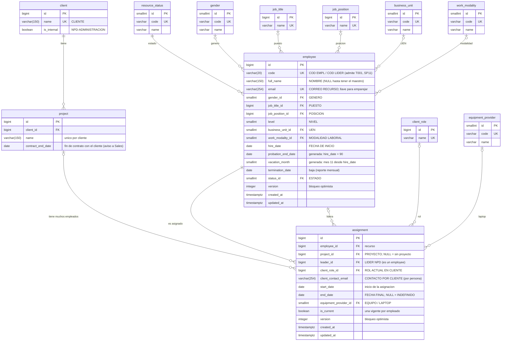
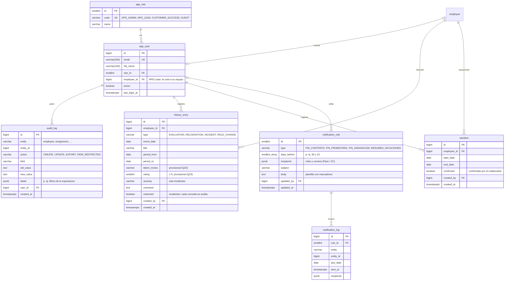

# Diagrama relacional de la base de datos (propuesta)

Modelo propuesto como corrección al PR `feature/postgres-flyway` (`V1__create_catalogs.sql`, `V2__create_resource.sql`). Se basa en:

- La hoja `PLANIFICADOR` del Excel `PLANIFICACION DE RECURSOS NPD__Operaciones.xlsx`. Sus problemas y cómo se resolvieron están en [`inconsistencias-excel.md`](inconsistencias-excel.md).
- Los mockups de Figma `NPD-InfosGroup` (Recursos, Registrar recurso, Historial, Auditoría, Vacaciones, Avisos, Usuarios y Tablero).

Idea central: separar **lo que es del empleado** (`employee`) de **lo que es de su asignación** a un proyecto (`assignment`). La fila del planificador ("recurso") la arma la vista `resource_v`. La aplicación es la fuente de verdad; los Excel posteriores son exportaciones.

## 1. Núcleo: planificador

## 2. Módulos de soporte (según los mockups)

## Decisiones

- **`employee`**: id interno + `code` de texto único. Los códigos temporales (`T001`, `SP11`) entran sin romper nada y, cuando reciban el definitivo, se actualiza `code` sin tocar ninguna FK. El emparejamiento entre cargas se hace por `email`.
- **El líder NPD es un `employee`** (`assignment.leader_id`). Se elimina `npd_leader`. Regla de migración: manda COD LIDER.
- **`assignment` es 1:N con `employee`**, con un índice único parcial `(employee_id) WHERE is_current`. Hoy hay una asignación vigente por persona; el historial ("Cambio de rol", "Raúl Batista: baja", roster "desde nov 2024") queda guardado sin migrar el esquema.
- **Sin `client_id` en `assignment`**: el cliente sale de `project`. Sin proyecto = `project_id NULL` y estado "Activo-Sin proyecto".
- **Por persona (en `assignment`)**: fecha final, rol, contacto y laptop. En el Excel cambian entre personas del mismo proyecto.
- **`hire_date` (contratación) y `assignment.start_date` son fechas distintas.** Ninguna está en el Excel actual; la primera se deduce de la columna FECHA DE INICIO (ver `inconsistencias-excel.md`). Nivel, UEN, modalidad y estado son del empleado (confirmado).
- **Probatoria y vacaciones se calculan** a partir de `hire_date`, según el Código de Trabajo de Panamá (prueba de hasta 3 meses; vacaciones tras 11 meses de trabajo). Las vacaciones que se toman de verdad van en `vacation`.
- **`version`** en `employee` y `assignment` sirve para el bloqueo optimista de la pantalla "Editar recurso · Conflicto de edición".
- **`audit_log`** guarda un cambio por campo (valor anterior → nuevo), las exportaciones con sus filtros y las consultas a información restringida.
- **`resource_status`** (catálogo inicial): `ACTIVO_ASIGNADO` "Activo-Proyecto Asignado", `ACTIVO_SIN_PROYECTO` "Activo-Sin proyecto", `LICENCIA` "Licencia", `BAJA` "Baja".
- **`resource_v`** (vista) reproduce las 22 columnas del planificador para Roster, Tabla y exportación. Si se mide que es lenta, se pasa a vista materializada sin cambiar las tablas.
- **Fase 3 (fuera de este modelo)**: riesgo de rotación (IA) e integración con Infosweb.
